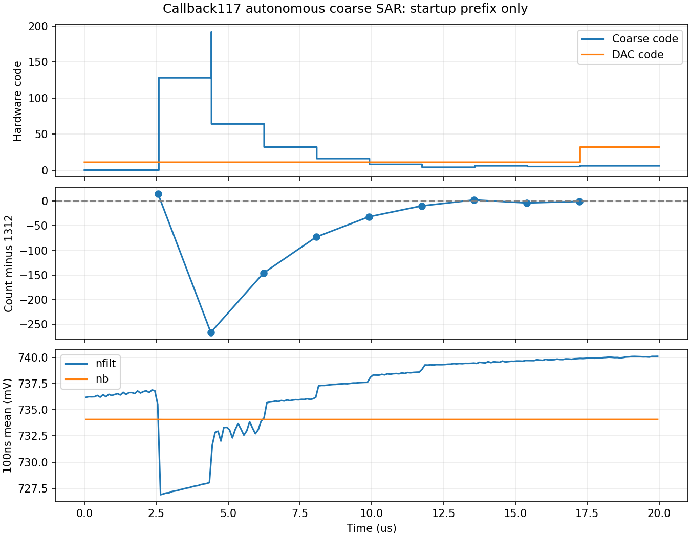

# 第118次：自主SAR选中粗码6，检查其上侧细调边界

117的20µs完整硬件启动前段已经自然结束并回收，未重启或修改。退出0、零错误、PSF END、10001点0–20µs有限物理波形和input/raw/log/final.ic哈希通过；两次独立终态相隔67.631607秒。Spectre实际耗时2小时16分58秒。units元数据NaN单独排除。117流水线已关闭，禁止重启、重复派发或再poll回收。

## 真实选码结果

冻结callback110全电路、recenter109控制器，原复位/配置激励与10µV差分LC种子；无强制码、nfilt暖初值、readic或状态绕过。电源预先建立为1.2V，并非电源爬升试验。仅K41/TT27°C/24MHz/10fF、AX8ps/1e-3/traponly/noise-off。

| 稳定EVAL时间µs | 粗码 | DAC | 计数 | 相对1312误差 | 实际下一粗码/DAC |
|---:|---:|---:|---:|---:|---:|
| 2.564 | 0 | 11 | 1326 | +14 | 128/11 |
| 4.398 | 128 | 11 | 1046 | −266 | 64/11 |
| 6.232 | 64 | 11 | 1166 | −146 | 32/11 |
| 8.066 | 32 | 11 | 1239 | −73 | 16/11 |
| 9.900 | 16 | 11 | 1280 | −32 | 8/11 |
| 11.734 | 8 | 11 | 1302 | −10 | 4/11 |
| 13.566 | 4 | 11 | 1314 | +2 | 6/11 |
| 15.398 | 6 | 11 | 1308 | −4 | 5/11 |
| 17.232 | 5 | 11 | 1311 | −1 | 6/32 |

端点检查及八次粗SAR的稳定字和实际下一码均符合冻结RTL的`measured > 1312`判据。最后一次粗码5计数1311，清掉当前最低位后保留4，再按原算法加2得到6；17.252µs进入粗码6/DAC32的细调。没有人为指定粗码6。

19–20µs：ctrl时间均值0.592001V；nfilt时间均值0.740059528V、范围0.738470944–0.741443297V；nb时间均值0.734069140V。内部周期观察器的RF均值3929.049031MHz，输出均值982.262076MHz。2ns保存不能直接解析RF边沿；这些周期观察值不能代替完整测量窗口的真实整数计数，也不是抖动。

enable/acquired/qualified/frequency_good/range_error/restart均未出现有效高电平。前20µs按计划只覆盖粗SAR及细调入口，不能据此判定完整捕获失败或成功。尚未运行到新计数复测、粗码余量修正或HANDOFF。

图中第一栏为保存点阈值解码，包含位切换瞬间的组合码；表格仅采用稳定EVAL字。偏置曲线为100ns分段均值。短记录与采样均值不证明渐近稳态。

证据：[独立终态与SAR复核](results/rt4_callback_sar117_review118.json)、[稳定字与偏置摘要](results/rt4_callback_sar_detail118.json)。原始数据位于research/runs/spectre_cmos_v14_full/rt4cbsar117ssd01/rt4_callback_sar117_tt，审计research/callback_sar117_terminal118_a.json及_b.json；结果JSON保存哈希。

## 唯一下一项：选中粗码的DAC49边界

此前115/116固定粗码8的DAC32/49计数5232/5254包围5248，但实际SAR选择6，且启动后的偏置不同。因此不将粗8局部结果直接套在粗6上，也不机械扫描相邻码。

`rt4cbedge118ssd01 / rt4_callback_edge118_tt`只做一个7µs、2线程TT局部计数检查：外部固定粗码6/DAC49，真实DAC、预置滤波器、禁用CP、RF÷4/RT4、MOS计数器与快照，使用原115/116外部门控和7µs记录。DAC49是冻结逻辑的上侧粗码修正门槛，不是插值拟合的锁定码。

nfilt初值0.740061298863V取自117的19–20µs保存点算术均值（与时间加权均值0.740059528V相差1.771µV），在t=0释放，仍保留真实1MΩ/10pF网络。其余状态重新初始化，没有加载117的final.ic。完整MOS尺寸、callback几何、模拟参数及控制器文件不变。

问题是：在这一明确的局部偏置初值下，粗6/DAC49的真实计数位于5248哪一侧，是否仍有条件上调余量；若偏低，离线RTL的`need_faster`谓词将为真。夹具缺少完整FSM、完整负载和启动历史，这不等于分支实际执行、连续两次合格或锁定。与115/116相比同时改变粗码及初值，不能单独归因于偏置；也不能与117的部分计数窗口拼成同条件调谐曲线。

[独立协议](results/rt4_callback_edge118_protocol.json)。输入manifest research/rt4_callback_edge_implementation118.json；唯一流水线research/rt4_callback_edge118_pipeline.json；审计research/audit_rt4_callback_edge118.py UNIQUE.json；有界入口poll_rt4_callback_edge118.py。runner存活由其回收，消失只接续原SSD目录，禁止重复启动launcher/runner/仿真。

仍AX8ps/reltol1e-3/traponly/noise-off，10ps保存，预期700001点0–7µs。完成需两次独立相隔至少60秒稳定终态、退出0/零错误、PSF END、input/raw/log/final.ic哈希与完整有限物理波形，再执行`review_rt4_callback_edge118.py 审计A 审计B 新输出JSON`。检查快照、门控/原始/缓冲时钟边沿，ctrl/preset，nfilt漂移及RF÷4。尚无118结果。

## 持续边界

本轮未增加120µs长记录或八次复测预算。117、115/116及所有既有完成任务不重跑。原109旧几何K41捕获通过仍独立保留，其粗码修正分支未触发；不能继承到callback或拼接全频。原4.4fF采用基线保持。

默认CDF几何不是布局/PEX，WPE默认off，尺寸修改须重新callback。最终10kHz至fOUT/2排除杂散RMS<200fs不变；115.2fs仅原RT4高偏移阶段依据，callback尚无噪声结论。功耗与后端后置，没有开始版图。
