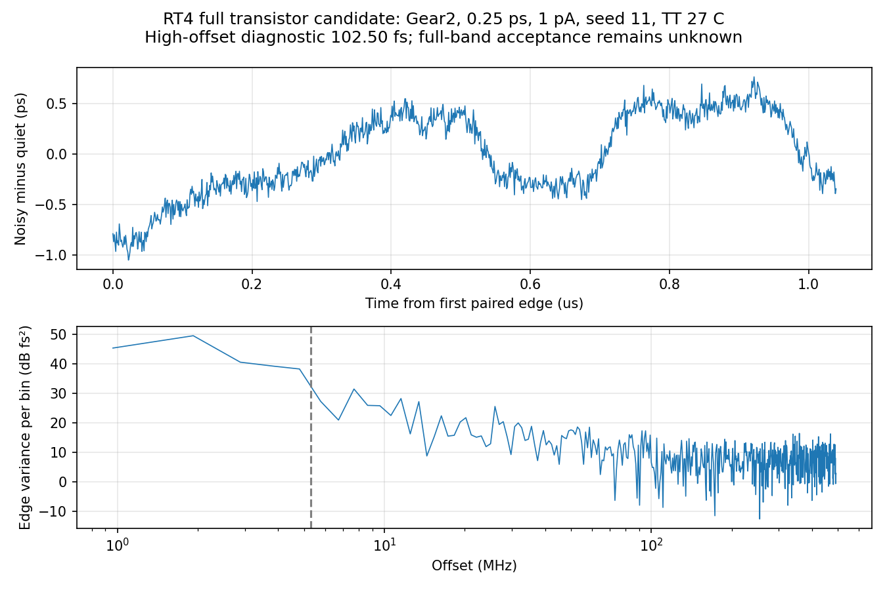
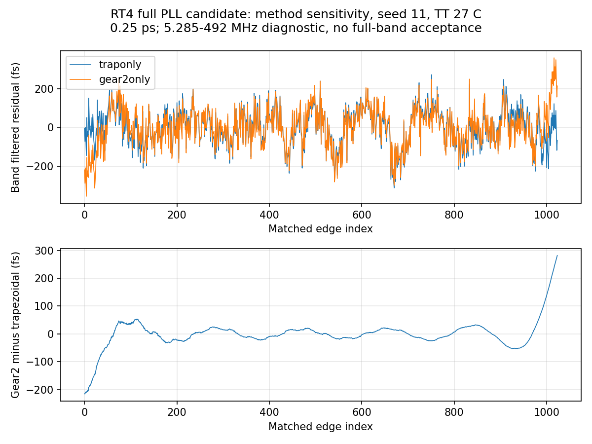

# 第90次完整PLL噪声审阅

2026-10-11T14:35:41+08:00。RT4 Gear完整噪声记录已独立复核，高偏移诊断102.496fs；同条件梯形法为95.862fs，矩形窗差异约6.92%且明显依赖有限记录窗，尚未建立数值收敛。已按原门限派发Gear seed29；原版320GHz噪声继续运行，最终全带抖动仍未知。

pllrt4gearquarteronssd01服务器原PID439942已退出，SSD终态码0，Spectre为0错误/1警告/15通知；日志时钟Oct10 13:26:21至Oct11 14:16:36，墙钟约24h50m15s。噪声于1µs开启，正常到达2.2µs；实际gear2only、0.25ps、reltol1e-6、1nV/1pA、noisefmin=1MHz/noisefmax=160GHz、seed11。

26输入及raw/log/终态等7输出通过远端前后哈希稳定和本地一致性检查。raw为9035334754字节，含完整END；独立解析11426987个时刻、23信号，与缓存所有差异为0，无重复或非有限值。19初始保存电压差0，终态7863项键集完整；实际readic绝对路径、终态及SSD归属另行核对。

完整RT4/newbank候选在TT27/1.2V/24MHz/K41/M4/984MHz/10fF/Q5RLC/CF10、理想外部参考和供电条件下，全部器件共同开启噪声。初始化、数值恢复、共同无噪声前缀、实际状态和专属quiet平稳性门限均通过；无Newton/LTE放松/跳断点/最小步长恢复或梯形振铃提示。用自有Gear quiet相减、仅去均值，1024边沿的5.28515625–492MHz RMS为102.495945208fs，独立复FFT与流水线一致，Parseval相对误差2.22e-16。未进行趋势拟合、幅度缩放或任意频点挖除。整段去均值残差RMS为400.117195fs，含未分类低频成分，不能视为10kHz随机抖动。

两套TB逐字比较仅积分方法traponly改gear2only，物理电路、初态、参考相位、容差、步长、种子、源带宽和时长一致，各用自己的quiet。梯形法/Gear高偏移RMS为95.862398905/102.495945208fs，相差6.633546303fs（6.919863%）；带内实现差值RMS为51.180979fs，相关系数0.868939。相同种子在自适应步长/不同积分方法下不代表相同激励；该差异混合有限记录与方法敏感性，不能作为绝对数值误差界。Gear可能存在人工阻尼，本次结果不能关闭方法收敛问题或支持采用RT4。

波形差值在记录边界较大，因此补做窗敏感性诊断。矩形窗主结果保持不变；采用sum(w²)噪声能量归一化的对称Hann窗，梯形法/Gear分别为100.399943/100.463361fs，差异0.063166%；两条残差首尾差为-0.059365/0.444034ps。窗函数改变有限记录权重和泄漏，不能独立分离物理低频噪声、求解误差与泄漏，也不能选择较低数字替代既定主结果或由此宣称方法收敛。

已按既定种子11/29对照补充pllrt4gearseed29onssd01：只将Gear noisy的noiseseed=11改为29，复用字节不变的Gear quiet并重新检查原五门限，0.25ps/1pA/160GHz及物理电路均不变。噪声关闭的quiet不受随机种子影响；第二种子在查看结果前固定，保留所有结果。原版pllmainbw320onssd01继续运行。实时核实2长任务、14请求线程、6个本地流水线/保护/runner，均在SSD，未重复派发历史任务；旧Gear三个本地进程正常退出。

原版320GHz quiet在1.92753µs内部节点XP.XC.XF.X57.XS.XN.x的梯形振铃风险继续开放：该节点未保存，振幅未知。RT4 Gear结果不能消除此原版风险。原版320GHz噪声尚未完成，不能报告带宽收敛。

最终10kHz至fOUT/2、排除离散杂散、RMS<200fs仍未知。原版和RT4仍分开；RT4未采用。原版既有0.5ps seed11/29为195.390405/163.650060fs，0.25ps 1pA为172.507488/160.410117fs；RT4 0.5ps为100.669316/112.993992fs，0.25ps为95.862399/103.195977fs，均是相同TT理想外部条件下的高偏移短记录。方法/带宽/更多种子/记录长度及完整离散杂散分类未闭合。33频点/完整PVT/MC/真实输入与负载/供电爬升/PEX仍缺；功耗超4mW、面积未验证，功耗优化及后端后置。 本轮新增RT4 Gear seed11高偏移102.495945fs；Gear seed29正在运行，不能将该记录代替原版结果或全带验收。

[原始数据复核](results/full_pll_rt4_gear_noise_recovery_audit.json)；[方法对照](results/full_pll_rt4_noise_method_comparison.json)；[下一种子协议](results/full_pll_rt4_gear_seed29_pair_protocol.json)。完整状态见[汇报](../../../reports/2026-10-11T1435.yaml)。
