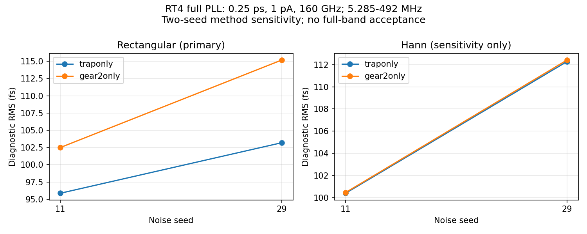

# 第92次完整PLL噪声审阅

2026-10-12T16:01:05+08:00。RT4 Gear seed29完整噪声记录通过独立复核，高偏移诊断115.195fs；两种子矩形窗方法差异6.92%/11.63%，Hann诊断差异0.063%/0.122%，有限记录敏感性仍显著。原版320GHz噪声继续运行，已启动原版内部振铃节点的梯形/Gear无噪声对照；最终全带验收仍未知。

pllrt4gearseed29onssd01原PID48240已退出，SSD终态码0，Spectre为0错误/1警告/15通知；日志时钟Oct11 14:32:38至Oct12 15:22:17，约24h49m39s。第91次独立回收器在两次稳定终态后回收并完成配对分析，15:35进入completed_pending_review，原保护器随后正常结束；没有重启该仿真。

26输入、实际readic初态及raw/log/终态等7输出核验通过，远端前后哈希稳定且与本地一致。raw为9034775589字节（SHA256 ec3f470c15097bd2310c2b2013bdfcd2c75322fd90b2ea0ad78d71b187658bba），包含完整END；独立解析11426223个时刻、23信号，与缓存全部数值差为0，无重复或非有限值。19初始电压差均0，终态7863项键集完整。

完整RT4/newbank候选，TT27/1.2V/24MHz/K41/M4/984MHz/10fF/Q5RLC/CF10、理想外部参考/供电；实际gear2only、maxstep0.25ps、reltol1e-6、1nV/1pA、源带宽1MHz–160GHz、seed29。噪声在1µs开启并正常达到2.2µs；初始化、数值恢复、共同quiet前缀、实际锁定状态和专属Gear quiet平稳性五门限通过，无Newton/LTE放宽/跳断点/最小步长恢复及梯形振铃提示。匹配1024输出上升沿，与自有quiet相减且仅去均值，5.28515625–492MHz RMS为115.195396866fs；独立复FFT与流水线一致，Parseval相对误差0。未拟合趋势、缩放幅度或任意挖除谱线。未滤波去均值残差286.098981fs含未分类低频成分，不能作为最终随机抖动。

| 方法 | seed11 RMS/fs | seed29 RMS/fs |
|---|---:|---:|
| traponly，矩形主结果 | 95.862399 | 103.195977 |
| Gear，矩形主结果 | 102.495945 | 115.195397 |
| traponly，Hann诊断 | 100.399943 | 112.286080 |
| Gear，Hann诊断 | 100.463361 | 112.423052 |

RT4方法×种子矩阵完成，逐字TB核对只改变方法或种子，物理依赖、初态、参考相位、步长、容差、噪声带宽和时长相同，各方法使用自有quiet。seed11：trap/Gear为95.862398905/102.495945208fs；seed29：103.195976726/115.195396866fs。矩形窗方法差异6.919863%/11.627798%；两种子方差均值开根为99.596710/109.030726fs，仅作描述统计，不给置信区间或收敛结论。相同seed在不同自适应积分方法下不代表相同噪声激励。

Hann采用sum(w²)能量归一化，ENBW1.501466bins；seed11的trap/Gear为100.399943/100.463361fs，seed29为112.286080/112.423052fs，方法差异0.063166%/0.121985%。残差首尾差trap11/trap29/Gear11/Gear29为−0.059365/−0.126725/+0.444034/+0.374644ps。两个种子都观察到窗口敏感性，不能分离真实低频成分、泄漏和积分误差；保留矩形窗主结果，禁止用Hann较小差异宣称方法收敛或选择较低数字。Gear人工阻尼与统计/时长收敛仍开放。

原版320GHz quiet曾在1.92753µs报告XP.XC.XF.X57.XS.XN.x梯形振铃，原记录未保存节点。已核实XC→XF→X57→XS→XN层级至pll_nand2内部串联NMOS节点x；find-node技能脚本只定位叶单元（其小写x_实例匹配不能覆盖本电路大写X层级），完整层级由逐级subckt/实例断言补充核验，8个新增观测节点均存在于原初态。新增两项噪声始终关闭的完整原版2.2µs诊断：pllmainringtrapoffssd01和pllmainringgearoffssd01，各4线程、相同31个保存信号和原初态；只改变积分方法。保持100fA/1nV/0.25ps、原物理电路与参考相位。先比较新增save的trap与旧quiet，再分析方法差异、内部节点交替步纹波及传播到输出的影响；不自动派发噪声，不把确定性时序差当作随机抖动。

15:54启动两项诊断，15:58复核：服务器原版320GHz noisy PID164688（7线程）；新trap PID256862、SSD cc34f46a，新Gear PID256863、SSD8b5b62e9（各4线程）。3长任务/15请求线程、6个本地runner/保护/回收/监护进程归属核实；新任务两次观察已从12ns推进至20ns且raw增长，实际锁定标志保持，无数值恢复。输入、cwd、raw、日志、TMPDIR均在SSD，单次派发claim有效；三套实际初态SHA一致于各自协议。诊断预计各4–8小时，属于估计，不能据超时判断完成。

原版内部振铃风险尚未关闭；原版320GHz noisy虽已超过此前告警时刻且暂无新增告警，仍不能证明对应quiet无振铃或噪声带宽收敛。RT4结果不能替代原版诊断。第91次本地进程消失原因仍未知；现有监护健康不代表根因已解决。

最终10kHz至fOUT/2、排除离散杂散、RMS<200fs仍未知。所有上述RMS均为TT984MHz理想外部条件、1024边沿、5.28515625–492MHz高偏移短记录；源噪声1MHz以下平坦处理不能代表10kHz闪烁噪声。原版与RT4分开，RT4未采用。原版0.5ps seed11/29为195.390405/163.650060fs，0.25ps1pA为172.507488/160.410117fs，100fA160GHz seed11为172.505385fs；RT4原0.5ps为100.669316/112.993992fs，0.25ps梯形为95.862399/103.195977fs，Gear为102.495945/115.195397fs。记录长度/源带宽/更多种子及完整离散杂散分类未闭合；33频点/完整PVT/MC/真实输入与负载/供电爬升/PEX缺口保留。功耗超4mW、面积未验证，功耗优化及后端后置。

[Gear seed29独立复核](results/full_pll_rt4_gear_seed29_noise_recovery_audit.json)；[方法与种子数据](results/full_pll_rt4_method_seed_matrix.json)；[原版内部节点诊断协议](results/full_pll_main_ringing_diagnostic_protocol.json)。全部12需求、14模块、六层状态见[完整汇报](../../../reports/2026-10-12T1601.yaml)。
