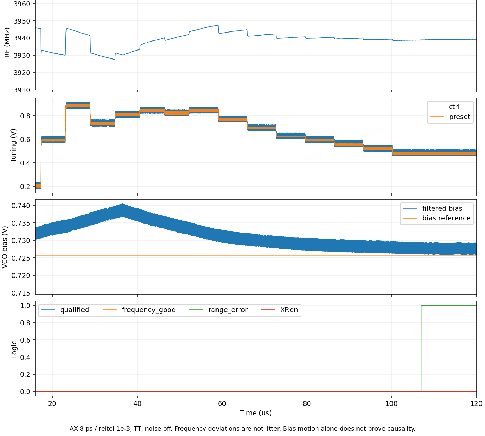

# 第106次：可变步长捕获结果与偏置诊断

2026-10-14T20:55:24+08:00

984MHz可变步长候选完整120µs仍未捕获：误差14降至3计数后耗尽8次预算，未交接PLL。已转入一个2.4µs局部偏置/调谐诊断。

末1µs输出平均984.796534MHz，范围984.774493–984.815402MHz，最大绝对测频偏差828.660ppm；qualified/frequency_good始终低。复测DAC46/42/38/34/32/30/28/26，对应计数误差14/11/8/5/5/4/4/3。106.920µs报range_error，无acquired、enable、HANDOFF或restart。频偏不是抖动。

远程任务正常结束；两次间隔60秒终态稳定，退出码0、Spectre零错误、输入/raw/日志/final.ic哈希、PSF END及60001点0–120µs有限物理波形全部核验。无Newton/LTE/skipped恢复标记。Spectre实际耗时14小时0分6秒；客户端延后回收不算仿真时间。

控制电压最终0.456751–0.512775V，未贴轨；VCO滤波偏置nfilt在SAR期约0.738V、末段约0.728V。原电路RF=1MΩ、CF=10pF的名义时间常数10µs；观察到偏置漂移，但其对频率的因果贡献尚待受控诊断，不能据此宣称根因已确定。

新任务rt4biasprobe106ssd02/rt4_biasprobe106_tt：一个2.4µs局部夹具、2线程，AX8ps/1e-3/traponly/noise-off。固定粗码19，用0.20/0.48/0.84V三个控制电压和0.728/0.738V两种偏置钳位，保留VCO/采样器/接收器/分频器/RT4负载；只隔离调谐范围及偏置敏感性。理想钳位不是生产电路，也不是完整PLL捕获或噪声证据。

首个短诊断在上传前因bridge重载旧SSH配置失败，核验远程目录和launch claim均不存在，未启动Spectre。保留失败记录；新run02在SSH实例构造后覆盖为既有thu-xia通道，并将辅助下载统一到该通道。未改全局SSH配置，未重启原长任务。

原4.4fF已采用基线、仅4.8fF、单步复测、可变步长四版本分开；三个低端锁定及6.821ppm仅属于原4.8fF控制器。新候选不继承噪声，全频不能拼接。115.2fs仅原RT4高偏移阶段依据；最终10kHz至fOUT/2排除杂散RMS<200fs不变。功耗与版图继续后置。

[完整状态](../../../reports/2026-10-14T2055.yaml)；[独立计数与终态复核](results/rt4_recheckstep_detail106.json)；[局部试验协议](results/rt4_biasprobe106_retry_protocol.json)。
